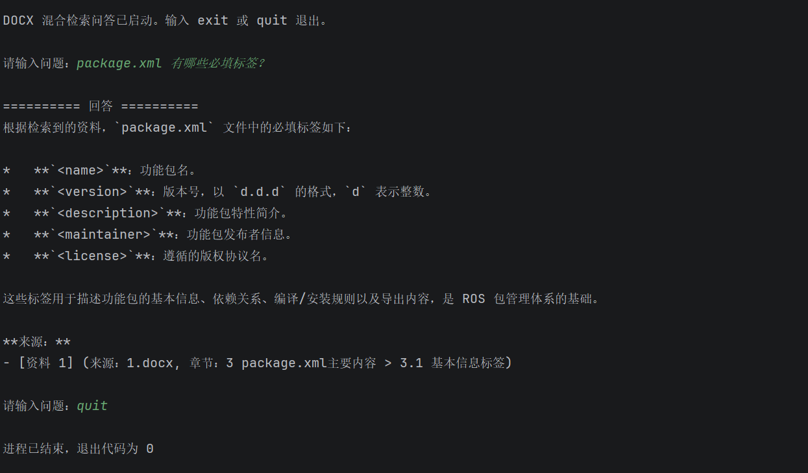
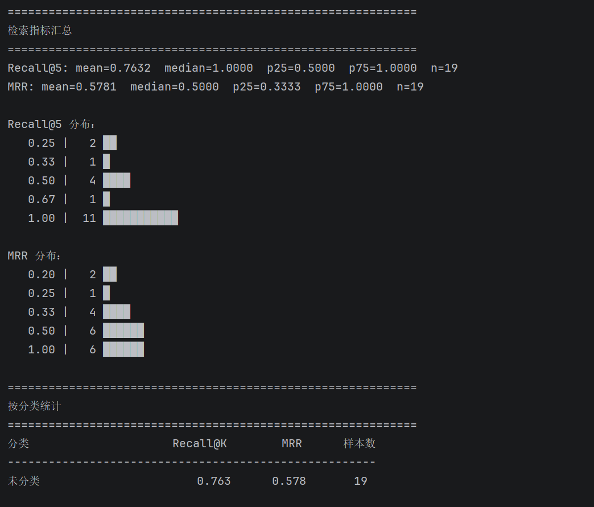

# DocRAG — 面向 ROS 技术文档的结构感知 RAG 系统

> 一个聚焦于复杂技术文档理解、混合检索、可复现评估与系统诊断的本地 RAG 项目。

DocRAG 面向 ROS（Robot Operating System）技术教程中的代码、命令、知识表格与多级章节结构，构建了一套从文档解析、结构感知分块、向量索引、混合检索到离线评估的完整 RAG 流水线。

项目的重点不仅是实现一个能够回答问题的 RAG 系统，还包括解决技术文档处理中容易被忽略的工程问题：如何保留原始文档结构、如何让语义检索与精确标识符检索互补、如何保证检索结果可追溯，以及如何通过评估与诊断定位系统的实际瓶颈。

**核心技术栈：** Python · LangChain · Chroma · Ollama · Embedding · BM25 · Reciprocal Rank Fusion (RRF) · Information Retrieval Evaluation

## 项目概览

| 维度 | 设计与实现 |
| --- | --- |
| 问题领域 | 复杂技术文档的知识检索与问答 |
| 输入数据 | ROS 中文技术教程（DOCX） |
| 文档处理 | 结构解析、标题识别、表格转换、代码识别、结构感知分块 |
| 向量检索 | Ollama Embedding + Chroma |
| 关键词检索 | BM25 + 面向中英文技术标识符的自定义分词 |
| 排序融合 | Reciprocal Rank Fusion (RRF) |
| 回答生成 | 基于检索上下文的本地 LLM |
| 评估体系 | Recall@K、MRR、检索确定性检查、标注审计 |
| 当前评估规模 | 19 条人工标注问题 |
| 部署设计 | 全本地推理与持久化，不依赖云端 API |

## 1. 项目背景：为什么技术文档 RAG 不能只做文本切分？

RAG 的效果不仅取决于模型本身，还取决于知识如何被解析、组织、检索和传递给模型。

ROS 技术教程是一个具有代表性的场景。与普通网页文本不同，这类文档经常将可执行命令、代码片段和知识表格放在 Word 表格中，同时通过章节编号表达复杂的上下文关系。

直接对文本进行提取和固定长度切分，会带来几个问题。

- **文档信息丢失：** 只读取 `python-docx` 的 `document.paragraphs`，会遗漏表格中的代码、命令和结构化知识。
- **代码语义破坏：** 固定长度切分可能截断命令，或者把代码与解释它的正文分离。
- **表格关系丢失：** 表格被拆成独立文本后，行列之间的对应关系可能不再清晰。
- **章节上下文缺失：** 即使检索到正确的内容，如果没有章节路径，模型也可能无法理解该内容讨论的具体对象。
- **技术标识符检索不稳定：** `geometry_msgs/Twist`、`/cmd_vel`、`catkin_package` 等标识符具有明确的字符形式，单纯依赖语义相似度未必能稳定召回。

因此，DocRAG 将问题拆分为三个层面：

1. **知识表示：** 如何尽可能忠实地保留源文档的结构与语义。
2. **信息检索：** 如何同时利用语义相关性和精确关键词匹配。
3. **系统评估：** 如何判断问题来自检索、分块、标注，还是回答生成。

这三个层面共同构成了项目的核心设计。

## 2. 系统架构

```text
                    ROS DOCX 技术文档
                            │
                            ▼
                 ┌────────────────────┐
                 │   Document Parser  │
                 │ 段落 / 表格 / 标题  │
                 │ 代码 / 命令识别     │
                 └─────────┬──────────┘
                           │
                           ▼
                 ┌────────────────────┐
                 │ Structure-Aware    │
                 │ Chunking            │
                 │ 章节路径 / 元数据    │
                 │ 特殊内容独立成块     │
                 └─────────┬──────────┘
                           │
                           ▼
                    chunks.jsonl
                           │
                           ▼
                 ┌────────────────────┐
                 │ Embedding Pipeline │
                 │ nomic-embed-text   │
                 └─────────┬──────────┘
                           │
                           ▼
                    Chroma Vector DB
                           │
                ┌──────────┴───────────┐
                │                      │
                ▼                      ▼
        Vector Retrieval          BM25 Retrieval
        语义相关性召回              精确词项召回
                │                      │
                └──────────┬───────────┘
                           ▼
                 Reciprocal Rank Fusion
                           │
                           ▼
                    Top-K Context
                           │
                           ▼
                   Local LLM Generation
                           │
                           ▼
                    Answer + Sources


             eval_queries.json
                    │
                    ▼
                evaluate.py
                    │
          ┌─────────┼──────────┐
          ▼         ▼          ▼
       Recall@K    MRR    Retrieval Audit
                             & Stability
```

### 核心模块

| 模块 | 主要职责 |
| --- | --- |
| `chunker.py` | 将 DOCX 解析为结构化知识单元，并执行结构感知分块 |
| `vectorize.py` | 生成 embedding，构建并持久化 Chroma 索引 |
| `vector_ask.py` | 实现纯向量检索与问答，作为对照基线 |
| `hybrid_ask.py` | 实现向量召回、BM25 召回、RRF 融合及上下文生成 |
| `evaluate.py` | 评估检索指标，检查结果稳定性，并审计人工标注 |
| `eval_queries.json` | 保存人工标注的问题、相关块、关键片段和参考答案 |

架构采用相对清晰的流水线划分：文档解析与分块负责知识表示，索引模块负责持久化，检索模块负责候选召回和排序，评估模块负责量化效果与定位问题。

## 3. 关键技术设计

### 3.1 DOCX 结构解析：恢复文档原始顺序

**核心问题：Word 文档的内容不仅存在于段落中，也存在于表格中。**

项目使用 `python-docx`，通过 `CT_P` 与 `CT_Tbl` 判断底层 XML 元素类型，并利用 `iterchildren()` 按原始顺序遍历段落与表格。

这一设计避免了先提取所有段落、再提取所有表格造成的内容顺序错乱。

解析过程重点处理以下问题：

- **段落与表格统一遍历：** 保留文档内容出现的原始顺序。
- **嵌套表格兼容：** 根据文档或单元格的容器类型获取对应 XML 元素。
- **文本规范化：** 处理不换行空格 `\xa0`、全角空格 `\u3000` 和冗余空行，同时保留代码所需的行内换行。
- **表格结构转换：** 将 Word 表格转为 Markdown，转义竖线和反斜杠，并补齐不同行的列数。
- **代码块识别：** 结合语言标签与命令起始特征，识别嵌入单元格的代码和命令。
- **标题识别：** 优先使用 Word 标题样式，随后通过章节编号正则识别未使用标准标题样式的内容。

代码识别采用两级判断策略：明确的语言标签属于强信号，`rosrun`、`catkin_make`、`import`、`#!/` 等特征属于启发式弱信号。这样可以在识别代码的同时，降低将普通文本误判为代码的概率。

标题识别则通过标题栈维护当前章节路径，使后续知识单元能够继承完整的章节上下文。

**设计价值：** 解析器不只是把 DOCX 转换为纯文本，而是尽可能保留后续检索所需的结构信息，为分块、索引和结果追溯提供统一的数据基础。

### 3.2 结构感知分块：让切分边界服从内容结构

传统固定长度分块将文本长度作为主要约束，但技术文档中的不同内容具有不同的完整性要求。

DocRAG 将解析结果统一为 `block`，并根据内容类型采取不同策略。

```python
{
    "type": "heading" | "text" | "table" | "code" | "command",
    "content": "...",
    "language": "bash",
    "headings": ["A", "B", "C"],
    "source": "xxx.docx",
    "sequence": 0
}
```

其中，`headings` 记录章节层级，`sequence` 记录内容在文档中的原始序号。

当前分块策略的核心规则如下：

| 内容类型 | 处理策略 | 设计目的 |
| --- | --- | --- |
| 标题 | 更新章节状态，并刷新文本缓冲区 | 避免普通文本跨章节合并 |
| 普通文本 | 按目标字符数合并 | 在上下文完整性与块长度之间折中 |
| 表格 | 独立成块 | 尽量保留完整的行列关系 |
| 代码 | 独立成块 | 避免代码被普通文本合并或切分 |
| 命令 | 独立成块 | 尽量保留命令的可执行形式 |

当前默认参数：

- `CHUNK_SIZE = 1000`
- `MIN_CHUNK_SIZE = 250`

短文本块仅在满足以下条件时合并：

1. 当前块与前一块均为普通文本。
2. 前一块长度小于最小长度阈值。
3. 合并后的长度不超过目标上限。
4. 两块的 `heading_path` 相同。

这种设计优先保证内容类型与章节边界的完整性，而不是为了填满每个 chunk 而无条件合并。

#### 章节上下文注入

仅在元数据中保存章节信息还不够。为了让 embedding 和 BM25 都能够利用章节语义，项目会将章节路径注入 chunk 正文：

```text
所属章节：第2章 ROS 通信 > 2.3 话题通信 > 2.3.1 创建发布者

具体知识内容……
```

同时保留以下元数据：

- `source`：来源文件
- `headings`：标题层级列表
- `heading_path`：完整章节路径
- `type`：内容类型
- `start_sequence`：起始序号
- `end_sequence`：结束序号

#### 稳定 ID 与数据一致性

每个 chunk 的 ID 由来源文件、起止位置和内容共同生成：

```python
identity = (
    first["source"]
    + str(first["sequence"])
    + str(last["sequence"])
    + content
)

chunk_id = hashlib.sha256(
    identity.encode("utf-8")
).hexdigest()[:20]
```

这一方案使相同输入和处理结果能够生成可复现的 ID，也为检索去重和评估标注提供稳定的关联键。

**关键权衡：** 项目优先保护代码、命令和表格的结构完整性，但这种策略也可能将解释正文与对应代码拆分到不同 chunk。这个取舍在后续评估中成为需要重点解决的问题。

### 3.3 向量化与持久化：保证索引可追溯

项目使用 Ollama 提供的 `nomic-embed-text` 生成 768 维 embedding，并通过 Chroma 保存向量、文档内容与元数据。

索引构建主要考虑三类工程问题。

**第一，metadata 类型兼容。**

Chroma 的 metadata 需要使用支持的标量类型。对于 `headings` 等列表值，项目将其序列化为 JSON 字符串，避免索引写入失败。

**第二，ID 一致性。**

向量化阶段显式传入 chunker 生成的 ID，并检查重复 ID，避免文档数量与预期不一致。

**第三，批量写入。**

默认以 32 个文档为一批写入，降低单次 embedding 请求过大的风险。

索引的设计不仅服务于相似度检索，还为后续的 BM25 召回、候选去重、人工标注与评估指标计算提供统一的数据基础。

### 3.4 混合检索：语义相关性与精确标识符互补

技术文档中的检索问题具有明显的双重性质。

例如：

- “怎么验证 ROS 安装成功？”更依赖语义理解。
- “`geometry_msgs/Twist` 包含什么字段？”需要准确匹配技术标识符。
- “`catkin_package` 有什么作用？”既需要找到相关概念，也可能需要定位具体代码和配置。

因此，项目实现了两条互补的召回路径。

**向量检索**

将问题转换为 embedding，在 Chroma 中进行相似度检索。该路径主要负责召回语义相关的内容。

**BM25 检索**

从 Chroma 中读取同一批已索引文档，构建 BM25 检索器。该路径主要负责匹配精确词项、文件名、命令和代码标识符。

两路结果通过 RRF 融合，而不是直接相加检索分数。

#### 面向技术文本的分词策略

BM25 使用自定义正则表达式保留技术文本中的标识符：

```python
tokens = re.findall(
    r"[a-z_][a-z0-9_./:+#-]*"
    r"|\d+(?:\.\d+)*"
    r"|[\u4e00-\u9fff]+",
    text.lower()
)
```

该策略可以整体保留 `rosrun`、`/cmd_vel`、`geometry_msgs/Twist`、`qwen3.5:9b` 和 `CMakeLists.txt` 等字符串。

对于连续中文，项目额外生成二元字符片段（2-gram），同时保留原始中文词串。例如，“话题通信”会额外产生“话题”“题通”“通信”等片段。

这是一种实现成本较低的近似方案，优势是无需额外分词依赖，局限是可能产生没有实际语义的片段。

#### RRF 排序融合

当前默认参数为：

| 参数 | 数值 |
| --- | ---: |
| `VECTOR_TOP_K` | 10 |
| `BM25_TOP_K` | 10 |
| `FINAL_TOP_K` | 6 |
| `RRF_K` | 60 |

RRF 的计算公式为：

\[
\operatorname{RRF}(d)=
\sum_{r \in \{\text{vector},\text{BM25}\}}
\frac{1}{K+\operatorname{rank}_r(d)}
\]

其中，\(d\) 表示候选文档，\(\operatorname{rank}_r(d)\) 表示文档在某一路检索中的排名。

选择 RRF 的主要原因是两路检索分数的量纲不同：

- BM25 得分没有固定的统一上界。
- 向量检索使用距离或相似度，其数值范围和含义不同。

直接将两类分数相加，可能导致某一路检索主导最终排序。RRF 仅利用排名信息，避免了直接对齐分数量纲的需要。

#### 检索结果去重与原始 ID 保留

在混合检索中，结果融合与评估都依赖准确的文档身份。

项目通过 Chroma 底层 `collection.query()` 获取原始 ID，并将其注入 `_chroma_id` 元数据，而不是仅依赖 `similarity_search()` 返回的 `Document` 对象。

去重时优先使用原始 Chroma ID；缺少 ID 时，再通过来源、位置与内容构造备用键。

这一设计同时解决了两类问题：

1. 两路召回命中同一文档时，需要正确去重。
2. 离线评估需要将召回结果与人工标注的相关 chunk ID 对齐。

**设计价值：** 混合检索不只是将两个 retriever 拼接起来，还需要解决分词、排名融合、文档身份保持和评估关联等问题，才能形成可分析、可验证的完整检索链路。

### 3.5 Prompt 工程：限制技术问答中的不可靠输出

技术文档问答与开放式聊天不同。回答中的命令、文件路径、配置参数或 ROS 接口名一旦被改写，就可能失去实际意义。

因此，项目的 system prompt 设置了明确的回答约束：

1. 优先依据检索上下文回答，不将猜测当作文档事实。
2. 上下文不足时，明确说明当前知识库无法确定，并指出缺失信息。
3. 保留命令、代码、配置项、话题名、服务名和文件路径的原始拼写。
4. 区分文档明确描述与模型推断。
5. 多个来源存在差异时，说明差异，不强行编造统一结论。
6. 在回答末尾列出来源、章节路径与内容类型。
7. 不声称已经执行命令或验证代码。

上下文组织时，将来源、章节路径、内容类型与正文一起传递给模型，帮助回答保留可追溯性。

当前混合检索方案将生成温度设为 `0`，优先考虑技术回答的稳定性。

需要注意的是，这些约束属于提示词层面的设计，并不意味着已经通过独立评估证明模型能够始终遵守所有规则。

## 4. 离线评估：从“能回答”到“能衡量”

检索系统如果只通过少量人工提问来判断效果，很难区分问题究竟来自分块、召回、排序、标注还是生成。

因此，项目通过 `eval_queries.json` 建立人工标注评估集，并在 `evaluate.py` 中实现检索指标计算、重复检索检查与标注审计。

### 4.1 评估集设计

每条评估样本可以包含：

| 字段 | 作用 |
| --- | --- |
| `question` | 用户问题 |
| `relevant_chunk_ids` | 人工标注的相关 chunk ID |
| `relevant_snippets` | 用于辅助判断相关性的关键文本片段 |
| `ground_truth` | 参考答案，为后续生成质量评估预留基础 |

其中，相关 chunk ID 是优先使用的强标注；没有 ID 标注时，才使用归一化后的 snippet 子串匹配。

文本归一化使用 Unicode NFKC 统一全角与半角形式，并移除空白字符，降低排版差异对匹配的影响。

### 4.2 Recall@K

Recall@K 衡量前 K 个结果覆盖了多少人工标注的相关块：

\[
\operatorname{Recall@K}
=
\frac{\text{Top-K 中命中的相关块数}}
{\text{标注的相关块总数}}
\]

实现中对命中数进行上限截断，避免重复命中导致指标超过合理范围。

### 4.3 Mean Reciprocal Rank（MRR）

MRR 衡量第一个相关结果在检索列表中出现得有多靠前：

\[
\operatorname{MRR}
=
\frac{1}{N}
\sum_{i=1}^{N}\frac{1}{r_i}
\]

其中，\(r_i\) 是第 \(i\) 个问题首次命中相关结果的排名；若没有命中，则该问题的 reciprocal rank 记为 0。

与 Recall@K 相比，MRR 更关注正确结果的排序位置。两项指标结合，可以分别观察相关内容的覆盖情况与首个正确结果的排序表现。

### 4.4 检索确定性检查

项目会对同一问题重复执行检索，并比较每次返回的 `_chroma_id` 序列。

当前默认重复 3 次，目的是发现相同问题是否出现不一致的检索排序。

这项检查目前只覆盖检索结果，不覆盖 LLM 生成答案的一致性。

### 4.5 标注审计与问题定位

标注审计用于区分“检索失败”和“标注或评估口径存在问题”。

主要检查内容包括：

- 人工标注的相关 ID 是否出现在 Top-K 结果中；
- 关键 snippet 是否实际存在于知识库中；
- 候选块的来源、章节与正文内容；
- 答案是否实际位于相邻 chunk；
- 标注结果是否需要人工复核。

对于 RAG 系统而言，单纯观察一个 Recall 数值不足以解释失败原因。将指标计算与候选结果审计结合，可以让后续优化更有针对性。

## 5. 实验结果与技术分析

### 5.1 当前评估结果

当前项目记录的混合检索指标如下：

| 指标 | 当前结果 | 样本数 |
| --- | ---: | ---: |
| Recall@5 | 0.763 | 19 |
| MRR | 0.578 | 19 |

Recall@5 为 0.763，表示按照当前标注与计算口径，前 5 个结果覆盖了约 76.3% 的相关块。

MRR 为 0.578，反映首个相关结果的排名仍有改进空间。若将该数值视为所有问题 reciprocal rank 的平均值，其对应的平均倒数排名约为 1.73；这并不意味着首个相关结果的实际平均排名必然等于 1.73。

**结果边界：** 当前评估集只有 19 条问题，适合用于发现趋势、分析失败案例和比较迭代方向，不足以证明系统对不同文档或不同问题类型具有稳定的泛化能力。

目前也没有足够的系统性 A/B 数据证明混合检索一定优于纯向量基线，因此不将该结论作为已经验证的实验结果。

### 5.2 核心发现：结构完整性与检索粒度之间存在权衡

当前排查发现的一个重要问题是：

> 检索结果可能已经到达正确章节，但真正回答问题的内容位于相邻 chunk，导致“检索位置接近正确”仍然被评估为未命中。

这与当前的结构感知分块策略存在直接联系。

**原因一：普通文本块偏小。**

`CHUNK_SIZE=1000` 可能将概念解释与命令示例拆分到不同块中。

**原因二：特殊内容独立成块。**

代码、命令和表格被独立保存，有利于保持内容完整性，却可能使解释文本与对应代码分离。

**原因三：合并规则较严格。**

短块合并仅作用于同类型、同章节的普通文本，不会跨越代码块或表格合并。

**原因四：评估粒度与答案上下文不完全一致。**

如果标注只记录答案所在 chunk，那么召回相邻块即使包含有用上下文，也可能被判定为不相关。

这揭示了一个重要的工程权衡：**以结构完整性为优先的分块方式，不一定能同时获得最佳的检索召回率。**

### 5.3 如何理解这个问题

该现象不能简单归结为 embedding 模型效果不够好。

它可能同时涉及：

- 文档切分边界；
- 代码与解释的关联方式；
- 检索返回单位与最终回答上下文的粒度；
- 人工标注的相关性定义；
- 评估指标对相邻块的处理方式。

因此，合理的优化方向不只是替换 embedding 模型，还应当调整知识表示、上下文组装与评估口径，并通过可比较的实验确认实际收益。

### 5.4 其他发现

| 问题 | 潜在影响 |
| --- | --- |
| 评估集只有 19 条 | 指标容易受到单个样本影响 |
| ID 标注与 snippet 兜底混用 | 不同样本的相关性判定口径可能不完全一致 |
| chunk ID 与分块版本耦合 | 分块策略变化后，旧标注可能失效 |
| 中文使用 2-gram 近似分词 | 可能引入噪声并降低关键词匹配精度 |
| RRF 两路等权 | 不同问题类型可能需要不同的召回权重 |
| `FINAL_TOP_K=6`、`RECALL_K=5` | 线上返回数量与评估范围不完全一致 |
| RAGAS 尚未真正接入 | 生成质量缺少独立的量化结果 |
| 确定性检查仅覆盖检索 | 无法反映生成答案的波动 |
| 两套问答脚本存在重复实现 | 增加维护成本与配置不一致风险 |
| collection 初始化参数可能不一致 | 可能引发向量距离度量不一致的问题 |
| 表格首行默认作为表头 | 部分数据表可能被错误转换 |
| 中文 Word 标题样式兼容不足 | 无编号标题可能无法正确识别 |

这些问题被作为明确的工程改进项，而不是被隐藏在一个整体指标之后。

## 6. 进一步优化方向

### 6.1 检索与知识表示

**父子块检索（Small-to-Big Retrieval）**

使用较小的子块进行精准召回，再返回更完整的父块或关联上下文，减少答案跨块导致的信息缺失。

**上下文增强的代码块**

将代码块与最近标题、前一段解释或关联文本建立显式关系，减少只检索到代码而缺少使用说明的情况。

**Overlap 与分块长度实验**

对比不同 `CHUNK_SIZE`、重叠比例与短块合并策略，观察检索指标及上下文质量的变化。

**重排序（Reranking）**

在初始召回后引入交叉编码器，对候选结果进行更精细的相关性排序。

**问题类型感知的混合检索**

针对命令、接口名和配置项等问题探索更高的 BM25 权重，并与当前等权 RRF 方案进行对照实验。

### 6.2 评估体系

- 扩充人工标注问题，并按命令类、概念类、配置类等类别分析指标。
- 同时保留相关 chunk ID 和关键文本片段，降低评估集对具体分块版本的依赖。
- 引入考虑相邻上下文的宽松命中口径，并与严格 ID 命中指标并列报告。
- 统一线上返回数量与 Recall@K 的评估范围。
- 接入 RAGAS，评估 Faithfulness、Answer Relevancy、Context Precision 和 Context Recall。
- 探索 LLM-as-Judge，对回答正确性与上下文支持程度进行辅助评价。
- 将确定性检查扩展到生成答案，观察相同问题多次生成的差异。

### 6.3 工程架构

- 抽取公共 `retriever.py`，统一向量检索与混合检索的基础逻辑。
- 统一 Chroma collection 的创建参数与距离度量。
- 将模型名称、检索数量、分块长度和存储目录集中到配置文件。
- 基于内容哈希实现增量索引，减少未变化内容的重复 embedding。
- 扩展 PDF、HTML 与 Markdown 文档解析能力。
- 在核心检索与评估流程稳定后，再考虑 API 或 Web UI 等交互层。

上述内容是后续规划，不代表相关功能已经完成或取得了实验收益。

## 7. 工程设计中的关键取舍

| 设计选择 | 主要收益 | 代价或局限 |
| --- | --- | --- |
| 结构感知分块 | 保留代码、表格与章节边界 | 可能增加相邻块之间的语义断裂 |
| 章节路径注入正文 | 增强上下文感知 | 增加重复文本与 embedding 输入长度 |
| 向量 + BM25 | 兼顾语义匹配与精确关键词 | 增加检索、去重和排序复杂度 |
| RRF 排名融合 | 避免直接相加不同量纲的分数 | 等权融合未必适合所有问题类型 |
| 自定义中文 2-gram | 依赖简单、实现成本低 | 中文词项质量与精度有限 |
| 确定性检索检查 | 发现重复查询的排序不稳定 | 不能替代检索质量评估 |
| ID 级相关性标注 | 判定明确、便于自动化 | 对分块版本变化敏感 |
| 全本地推理 | 减少对云端服务的依赖 | 受本地硬件与模型能力限制 |

这些取舍反映了当前实现的设计边界，也为后续实验提供了明确的变量。

## 8. 项目价值与技术能力覆盖

DocRAG 涉及的技术能力不仅限于调用 LLM 接口，而是覆盖了从数据处理到检索评估的多个环节。

| 技术领域 | 项目中的体现 |
| --- | --- |
| Python 工程实现 | 模块化脚本、数据结构设计、异常检查 |
| 文档解析 | DOCX XML 结构遍历、表格转换、标题识别 |
| 数据处理 | 结构化中间表示、文本清洗、元数据规范化 |
| 信息检索 | Dense Retrieval、BM25、RRF |
| Embedding 与向量数据库 | Ollama Embedding、Chroma 持久化 |
| LLM 应用 | 上下文组装、Prompt 约束、来源追溯 |
| 实验评估 | Recall@K、MRR、重复检索检查 |
| 问题诊断 | 标注审计、相邻块漏召回分析、指标口径分析 |
| 系统设计 | 模块职责划分、数据一致性、检索与评估链路设计 |

项目当前最值得深入讨论的部分，是如何把一个表面上简单的 RAG 问答需求，拆解为可独立分析的数据表示、检索、排序和评估问题，并通过具体实现与失败案例建立改进方向。

## 9. 实际运行截图



